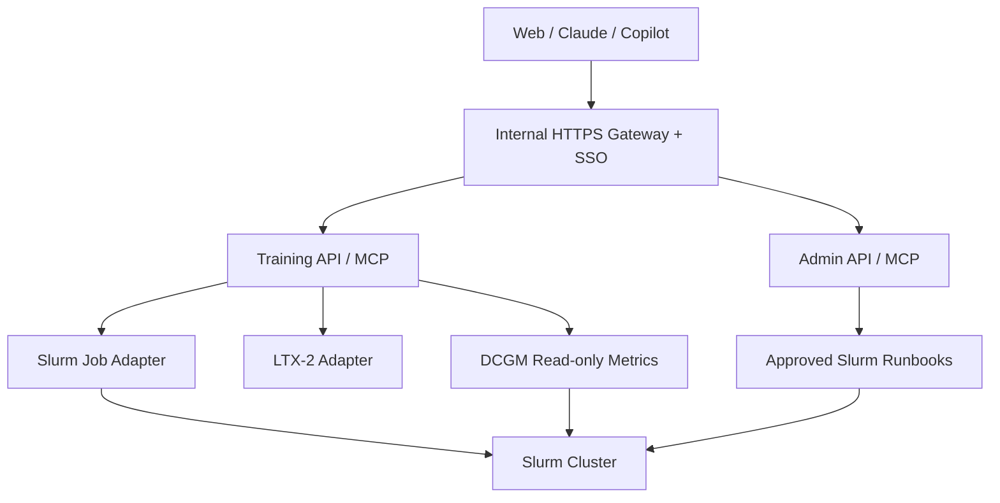

# GPU Platform 架構決策

狀態：已接受方向，實作細節仍需逐項規格化
日期：2026-09-19

## 目標

以私有控制層整合三個持續追蹤上游的開源專案：

- Slurm：叢集排程與內部維運
- LTX-2：模型與訓練能力
- DCGM：GPU 健康狀態與監控資料

控制層同時支援 Slurm 管理和實驗訓練，但兩者必須使用不同的權限、API 與部署邊界。

## Repository 邊界

```text
gpu_training/              # 私有控制層，現階段的整合入口
slurm/                     # 獨立 upstream checkout 或內部 fork
LTX-2/                     # 獨立 upstream checkout 或內部 fork
DCGM/                      # 獨立 upstream checkout 或內部 fork
```

- 不把 Slurm、LTX-2 或 DCGM 原始碼複製進 `gpu_training`。
- 每個開源 repo 獨立同步 upstream、建立內部 branch、建置及驗證。
- `gpu_training` 記錄已核准的 component commit、版本、相容性及部署狀態。
- Source checkout、build artifact、installed version 與 running version 分別採證，不互相推定。

## 服務邊界



### Training domain

- 一般內部使用者只能提交、查看及取消自己的 job。
- 訓練請求使用結構化參數與核准模板，不提供任意管理 shell。
- 每次實驗記錄 source commit、environment/container、dataset、參數及輸出位置。
- Training API/MCP 不可取得 daemon restart、節點設定或跨使用者取消 job 的權限。

### Admin domain

- 僅管理員可使用，與 Training API 採用不同身分和授權範圍。
- 查詢操作與變更操作分開；restart、drain、升級及設定變更需要核准、審計與回滾步驟。
- 只暴露預先定義的 runbook，不提供通用 SSH、`systemctl` 或 shell 工具。

## Training 抽離策略

現階段 Training domain 可以和控制層放在同一個私有 repo，但從第一天維持獨立模組：

```text
gpu_training/
├── platform/              # auth、RBAC、audit、共用 contracts
├── services/
│   ├── admin/             # Slurm 維運能力
│   └── training/          # 可抽離的 Training API/MCP
├── adapters/
│   ├── slurm/
│   ├── ltx2/
│   └── dcgm/
├── config/                # component pins 與 environment 設定
└── deploy/
```

`services/training` 只能透過穩定 contract 使用共用能力，不直接依賴 Admin domain。需要獨立擴展、不同發布週期或不同安全邊界時，可將它搬到新的 private training repo，而不改變對外 API。

## Wave 工作流位置

Wave 的權威流程與跨 repo 狀態放在私有控制 repo，也就是現階段的 `gpu_training`；不要在三個 upstream checkout 各複製一套。

```text
gpu_training/
├── .claude/CLAUDE.md      # 團隊工作手冊
├── .claude/skills/        # Claude 共用工作流
├── .github/prompts/       # Copilot 入口
├── openspec/              # 跨 repo proposal、design、spec、tasks
├── ROADMAP.md
├── ISSUES.md
├── TEAM_LOG.md
└── scripts/               # setup 與 workflow validators
```

放置原則：

- 跨 repo 整合、production rollout、Slurm 升級和平台權限變更：在控制 repo 建立 Wave。
- 單一上游 repo 的原始碼修改：Wave lane 仍由控制 repo 追蹤，實作 commit/PR 留在該 repo 的內部 fork。
- 每個 lane 必須標示目標 repo、branch、允許修改的檔案、驗證命令與依賴的 component commit。
- GitHub issue 建在明確指定的私有 repo；不得由 upstream remote 推定 issue 目的地。
- 開源 checkout 只保留該專案必要的測試、建置設定及最薄的 agent 指引，避免內部狀態干擾 upstream sync。
- 同一項 task 只保留一個權威 checklist；其他 repo 只連回 Wave issue 或 OpenSpec change。

目前 Slurm repo 已存在的 active changes 先完成並 archive，不在進行中搬動。之後新的跨 repo Wave 改由私有控制 repo 建立，再逐步移轉共用 skills、prompts 和 validators。

## 版本更新原則

```text
偵測 upstream 更新
  -> 建立 Wave / issue
  -> 在對應 repo 的內部 branch 建置與測試
  -> 執行跨 component staging 驗證
  -> 更新核准版本清單
  -> 維護窗口部署
  -> 驗證或回滾
```

- Slurm 與 DCGM 不自動更新 production。
- LTX-2 可以使用較快的更新週期，但正在執行和可重現的實驗必須固定 commit。
- 更新偵測可以自動化；合併、部署及具有營運影響的操作必須經人工核准。