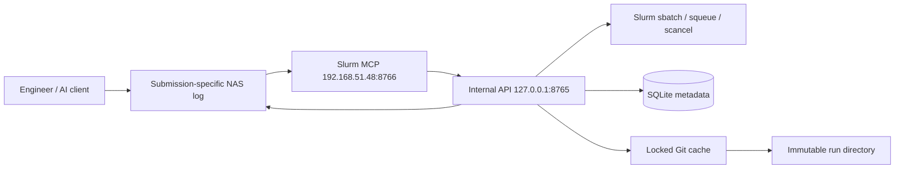

# GPU Platform v1 工程師交付與部署指南

## 0. 現況與下一步

這不是 greenfield 安裝。2026-09-29 的 read-only 採證結果如下：

- `ia-ai-server-5` 的 `slurmctld` 正常運作，版本為 `21.08.5`；本次升級不修改或重啟 Slurm controller。
- `slurm-api.service` 與 `slurm-mcp.service` 均為 active，從 `/storage/SSD2/hank/gpu_training` 以 `/usr/bin/python3` 直接執行。
- 兩個 legacy services 目前監聽 `0.0.0.0:8765` 與 `0.0.0.0:8766`，API `/health` 回傳 `404`。
- v1 source、tests、deployment files 仍在未提交的 working tree；`HEAD` `6046d6869749ac07491100aa60cec0018ac0184b` 是目前可辨識的 legacy rollback candidate。
- `/opt/gpu-platform` 尚不存在；第一次 rollout 必須先建立 immutable legacy snapshot 與 rollback units，不能假設已有 previous release symlink。
- 目前沒有 active nginx service 或 `8443` gateway listener。

因此現在不要直接 restart 現有 services。現有 units 指向 mutable checkout；service crash、restart 或 reboot 都可能載入尚未 release 的 v1 source，並因新版預設 loopback bind 讓既有 direct clients 失去連線。

你現在要做的是一次受控的 in-place application upgrade：

1. **現在，無停機**：由 legacy commit 建立 immutable rollback snapshot/units，將 v1 變更 commit/push/tag，重跑 preflight，建立並保存 artifact/SHA-256。
2. **現在，做決策**：選定 service account、工程師的內網 HTTPS/VPN gateway URL、存取政策、maintenance window 與 reviewer。
3. **維護窗口**：備份 live units/config，安裝 versioned release/venv/gateway，只切換 `slurm-api` 與 `slurm-mcp`。
4. **切換後**：執行 read-only API health、MCP discovery；失敗立即回復 legacy release。
5. **另行核准**：透過 MCP 執行一個 canary，通過後才把 v1 endpoint 與操作說明交給工程師。
6. **工程師端**：不安裝 Slurm、API 或 MCP server；只設定 MCP client，取得自己的 `username`、approved `venv` 與 repository/data 權限。

## 1. 交付狀態

目前 OpenSpec change `launch-platform-v1` 完成 `15/17` tasks。程式、離線 deployment artifact 與 rollback 文件已完成；既有 legacy deployment 尚未切換到 v1，v1 canary 也尚未執行。

| 能力 | 狀態 | 如何達成 | 驗證證據 |
|---|---|---|---|
| MCP-only AI training | 完成 | AI client 只註冊 MCP；`username`、`venv` 必填；backend success 必須有 submission ID、job ID、status | Mocked MCP/API contract tests |
| Internal API boundary | 完成 | 只接受 `mcp`/`internal-ui` source header，Pydantic 拒絕額外欄位，legacy `script_path` 不可由 agent 使用 | FastAPI client tests |
| Submission metadata | 完成 | SQLite additive migration，唯一 `submission_id`，保存 source/run/script/log/request/status | Temporary SQLite migration tests |
| 同名併發隔離 | 完成 | Submission UUID 決定 script/log 目錄；temp file、`fsync`、`os.replace` 原子寫入 | 16-way threaded test |
| 固定 source commit | 完成 | Per-repository file lock、mirror cache、接受時解析 commit、獨立 detached run directory | Temporary Git remote concurrency tests |
| 精確 log 與 recovery | 完成 | Job ID 由 metadata 找 exact log；metadata finalize 失敗留下 recovery JSON 與真實 job ID | Decoy log/partial failure tests |
| Safe retention | 完成 | List + dry-run；先查 Slurm active IDs；查詢失敗 fail closed；只刪 managed roots | Active/inactive fixture tests |
| Versioned deployment | 完成 | v1 manifest、Python 3.10.12、exact lock、loopback systemd units、gateway 範例、deterministic tar | Config parser、double-build comparison、clean venv exact-lock test |
| Offline preflight | 完成 | Syntax -> 20 tests -> OpenSpec -> Wave -> deployment -> runbook -> whitespace | Slurm job `528` passed |
| Live rollout | 待 Owner 核准 | 依 rollout runbook 備份、切換、read-only health、可回滾 | OpenSpec task 4.4 |
| Canary training | 待另行核准 | 經 deployed MCP 提交固定 fixture，驗證完整 metadata 與 terminal state | OpenSpec task 4.5 |

實作者只把已完成項目標成 fixed；verified 必須由另一位 reviewer 重跑驗收。

## 2. 系統如何運作



一次有效 submission 的流程：

1. MCP 驗證非空白 `username`、`venv`，送出結構化 request 與 `X-Submission-Source: mcp`。
2. Internal API 驗證 caller、command、GPU、job name、repo path 與額外欄位。
3. 系統在任何 preparation 前建立 UUID `submission_id`。
4. Per-repository lock 保護 mirror fetch；branch/ref 在接受時解析成 `source_commit`。
5. 固定 commit materialize 到 submission 專屬 immutable run directory。
6. Script 以原子方式寫入 submission 目錄，log path 同樣包含 submission ID。
7. `sbatch` 成功後回填 Slurm `job_id`，再一次寫入完整 metadata。
8. 若 metadata finalize 失敗，回應 partial failure，保留真實 job ID 與 recovery JSON，不宣稱完整成功。

## 3. 資料與 artifact 位置

| 類型 | 位置 |
|---|---|
| Submission DB | `/storage/SSD2/hank/gpu_training/slurm_history.db` |
| User work base | `/storage/SSD2/slurmjob/<username>/` |
| Immutable runs | `/storage/Internal_NAS/slurm-runs/<username>/<submission_id>/` |
| Source cache | `/storage/Internal_NAS/slurm-source-cache/<username>/` |
| Logs | `/storage/Internal_NAS/logs/<username>/<submission_id>/` |
| Recovery records | `/storage/Internal_NAS/slurm-recovery/` |
| Shared training venvs | `/storage/Internal_NAS/venvs/<name>/` |
| Generated scripts | `/tmp/slurm-generated/<submission_id>/job.sh` |
| Release artifact | `gpu-platform-v1.0.0.tar.gz` + `.sha256` |

不要手動刪除上述 state。Retention 必須走已實作的 list/dry-run/active-job check。

## 4. 角色與安全邊界

| 角色 | 責任 |
|---|---|
| Owner | 核准 target node、maintenance window、影響、rollback 與 canary fixture |
| Operator | 執行 preflight、build、backup、service rollout、health check、rollback |
| Engineer | 只設定核准 MCP endpoint，透過 MCP tools 使用 Slurm |
| Reviewer | 重跑 acceptance，決定 verified；不得由實作者代替 |

v1 是 trusted-internal release：

- Internal API 只綁 `127.0.0.1:8765`；pilot MCP 只綁 controller 私有位址 `192.168.51.48:8766`。
- 一般 AI client 只取得 `/mcp` endpoint，不取得 loopback internal API。
- `username` 目前是必要 audit identity，不是完整 authentication proof。
- 完整 SSO/RBAC、per-user job ownership 與 public multi-tenant exposure 不在 v1；完成前不得公開到 Internet。
- Training MCP 沒有 Slurm daemon restart、任意 admin shell 或 live config 能力。

## 5. 部署前準備

Operator 必須先確認：

1. Target node 能讀取 `/storage/Internal_NAS/`、`/storage/SSD2/` 與 `/etc/slurm/slurm.conf`。
2. `/usr/bin/sbatch`、`squeue`、`scancel`、`sinfo` 可用，且 approved service account 已確認。範例 unit 目前使用 `hank`，不是可直接套用的身分決策。
3. Python 版本為 manifest 指定的 `3.10.12`。
4. Node.js 20+ 與 OpenSpec CLI 可供 preflight 使用。
5. 工程師位於受信任私有網路，且 `192.168.51.48:8766` 不可由 Internet 存取；未來 HTTPS/VPN gateway 另行核准。
6. [rollout runbook](platform-v1-rollout.md) 的 change record 全部填妥。

若 service account、release path 或 Python 版本要改，先更新 manifest/units 並建立新 artifact 版本，再完整重跑 preflight；不要在 target node 臨時 patch release。

## 6. 離線 qualification 與 build

在 source checkout 執行：

```bash
cd /storage/SSD2/hank/gpu_training
source "$HOME/.nvm/nvm.sh"
nvm use 20

PYTHON_BIN=<approved-test-python> ./scripts/preflight-v1.sh

export ARTIFACT_OUTPUT_DIR=/tmp/gpu-platform-artifacts
./scripts/build-platform-v1-artifact.sh
sha256sum --check \
  "$ARTIFACT_OUTPUT_DIR/gpu-platform-v1.0.0.tar.gz.sha256"
```

保存 preflight 完整輸出、artifact path、SHA-256 與 manifest。Builder 輸出 deterministic tar；同一 source 重建應得到相同 bytes。

目前已保存的驗證：

- Job `528`：20 tests 與全部 preflight gates passed。
- Job `531`：clean disposable venv install、`pip check`、service imports 與 normalized `pip freeze` exact diff passed。

## 7. Live rollout handoff

以下只在 Owner 已核准 task 4.4 後執行。完整備份、health 與 rollback 要求以 [rollout runbook](platform-v1-rollout.md) 為準。

先設定並記錄：

```bash
export VERSION=1.0.0
export ARTIFACT=/tmp/gpu-platform-artifacts/gpu-platform-v1.0.0.tar.gz
export RELEASE_ROOT=/opt/gpu-platform/releases/$VERSION
export VENV_ROOT=/opt/gpu-platform/venvs/$VERSION
export BACKUP_ROOT=/opt/gpu-platform/backups/<approved-timestamp>

sha256sum --check "$ARTIFACT.sha256"
python3 --version
squeue -h -t PENDING,RUNNING -o '%i %u %T %j %N'
systemctl show -p FragmentPath slurm-api.service slurm-mcp.service
readlink -f /opt/gpu-platform/current || true
```

核准後的安裝順序：

1. 將上一版 release pointer、service units 與 gateway config 複製到 `$BACKUP_ROOT`。
2. 建立 `$RELEASE_ROOT`，將 tar 以 `--strip-components=1` 解壓至該目錄。
3. 以 Python 3.10.12 建立 `$VENV_ROOT`，安裝 `requirements-service.lock`，執行 `pip check` 與六個 service imports。
4. 執行 `systemd-analyze verify` 與 gateway parser check。
5. 安裝 review 後的 units；API 維持 loopback，MCP 只綁 `192.168.51.48`，不得使用 `0.0.0.0`。
6. 一般 engineer 只取得 MCP URL，不得直接看到 internal adapter；未來 gateway 切換另走獨立 rollout。
7. 原子更新 `/opt/gpu-platform/current`，執行 `systemctl daemon-reload`，只切換 `slurm-api` 與 `slurm-mcp`。
8. 執行 read-only health checks；任一失敗立即依 runbook 恢復 previous units/config/release。

不要把 `deploy/platform-v1/nginx/gpu-platform.conf` 不經 review 直接複製到共享 gateway；它是 loopback-safe parser 範例，實際 TLS、DNS 與存取政策屬於 site configuration。

## 8. 部署後驗收

Operator 保存以下輸出：

```bash
curl --fail --silent --show-error http://127.0.0.1:8765/health
systemctl is-active slurm-api.service slurm-mcp.service
journalctl -u slurm-api.service -u slurm-mcp.service --since '<rollout-start>' --no-pager
```

另執行 protocol-aware read-only smoke：

```bash
bash /opt/gpu-platform/current/deploy/platform-v1/smoke-mcp.sh
```

它會執行 MCP initialize、tool discovery 與 read-only `cluster_info`，不提交 job。

API health 必須回傳：

```json
{
  "status": "ok",
  "service": "slurm-api",
  "version": "1.0.0"
}
```

## 9. 工程師 onboarding

每位 engineer 由管理員提供：

- Pilot MCP URL：`http://192.168.51.48:8766/mcp`
- 已確認的 `username`
- 可用 shared `venv` 名稱
- 可存取的 source repository 與 branch
- `/storage/Internal_NAS/` 下的 dataset/input path
- GPU、memory 與允許 node 政策

Claude Code 的 machine-local 設定範例：

```json
{
  "mcpServers": {
    "slurm-gpu-cluster": {
      "command": "npx",
      "args": ["-y", "mcp-remote", "http://192.168.51.48:8766/mcp", "--allow-http"]
    }
  }
}
```

不要提交 endpoint、token 或憑證到 Git。VS Code Copilot 與其他 client 也只註冊同一個 MCP URL；細節見 [MCP 使用說明](../MCP_GUIDE.md)。

## 10. 工程師日常使用

建議 prompt 包含完整 request：

```text
我的 username 是 alice，venv 是 ltx2。
請從 git@github.com:org/model.git 的 main branch，
用 2 張 GPU、32G memory 執行 python train.py --config configs/base.yaml，
job name 是 alice-baseline。
```

成功回應至少包含：

```json
{
  "success": true,
  "submission_id": "<uuid>",
  "job_id": "<slurm-job-id>",
  "status": "submitted"
}
```

常用工具：

| 工具 | 用途 |
|---|---|
| `list_venvs` | 查看核准 shared venv |
| `cluster_info` | 查看節點與 Slurm 資源 |
| `gpu_status` | 查看 GPU 與 process 狀態 |
| `submit_job` | 提交 training |
| `list_jobs` | 查看 pending/running jobs |
| `get_logs` | 以 job ID 讀取 metadata 綁定的 exact log |
| `job_history` | 查看 metadata history、submission ID 與短版 source commit |
| `cancel_job` | 取消 job；v1 trusted-internal 階段依內部政策使用 |

工程師不得：

- 直接 SSH 到 worker 啟動 training。
- 在 IDE terminal/notebook 本機執行 training 作為 MCP fallback。
- 將 raw adapter URL 設成 agent action。
- 猜測別人的 username/venv 或手動改 submission metadata。
- 刪除 run、log、SQLite、recovery、source cache 或 Slurm spool。

## 11. 故障處理

| 現象 | 處理 |
|---|---|
| MCP 無法連線 | 停止 submission；檢查 VPN/gateway、MCP service 與 client config，不走 raw API fallback |
| 缺少 username/venv | 由使用者或管理員確認後再送，不能猜測 |
| Source preparation failed | 檢查 repo URL、branch、service account Git 權限與 NAS cache 權限 |
| Metadata finalize failed | 保存 response 中的 job ID，查 `/storage/Internal_NAS/slurm-recovery/`，operator 決定追蹤或取消 |
| 找不到 log | 先查 job metadata 中的 exact `log_path`；不要用 wildcard 猜第一個檔案 |
| Cleanup 遇到 active job | 保留 artifact；Slurm query 失敗時 cleanup 會 fail closed |
| Health check 失敗 | 不提交 canary，依 runbook rollback 並保存證據 |

## 12. 交付完成定義

目前可交付的是「通過離線驗證的 v1 release candidate」。要宣告可供工程師正式使用，仍需：

1. Owner 核准並完成 task 4.4 live rollout。
2. Read-only health 與 MCP discovery 通過。
3. Owner 另行核准 task 4.5 canary 的 username、venv、GPU、fixture、node 與 rollback。
4. 非實作者 reviewer 重跑 acceptance 並標記 verified。

在此之前，工程師可 review 文件與 client 設定，但不應被告知 production endpoint 已上線。